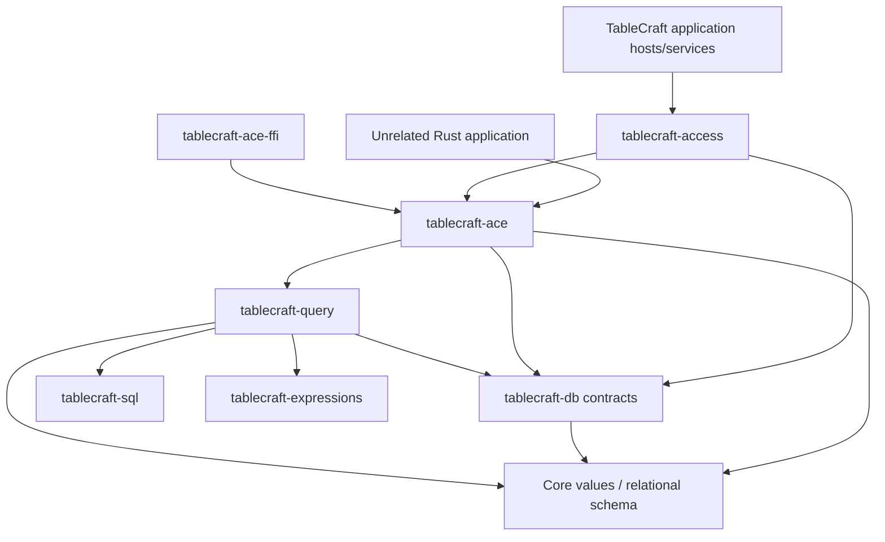

# Standalone native Jet/ACE engine boundary

TableCraft's native database implementation must be usable by an unrelated Rust
application without installing the TableCraft CLI or importing its application
runtime, UI, forms, reports, designers, collaboration services or adapters.
This is an architectural requirement adopted from the supplied engine proposal.

The intended engine name is **TableCraft ACE**, with package `tablecraft-ace`
under `crates/engines/`. It is an independent Rust implementation targeting
documented and experimentally qualified Jet/ACE behavior, not a wrapper around
Microsoft's provider or a claim of Microsoft affiliation.

## Current status

The first working `tablecraft-ace` slice provides [read-only header/catalog inspection](NATIVE_READING.md).
Bounded scalar table/schema reading is documented in [NATIVE_TABLES.md](NATIVE_TABLES.md);
the working Access adapter supplies query Source snapshots in [NATIVE_QUERIES.md](NATIVE_QUERIES.md).
There is no FFI package, ODBC driver or published engine release yet. Current working packages provide core values/budgets, Access SQL syntax,
initial scalar evaluation, scalar schemas, bounded retrieval over explicit host
sources and a headless CLI. The CLI's `query eval` evaluates
source-free expressions; it does not open MDB/ACCDB files or execute database
queries. See [IMPLEMENTATION.md](IMPLEMENTATION.md).

This document defines ownership and acceptance requirements for implementation.
It does not add placeholder packages, promise release dates or establish native
compatibility. Existing `publish = false` library manifests remain unchanged.
The private architecture pack remains ignored.

## Engine and adapter responsibilities

| Owner | Intended responsibility |
| --- | --- |
| `engines/tablecraft-ace` | Reusable native MDB/ACCDB storage and public Rust engine API, including native locking, transactions and supported SQL integration |
| `storage/tablecraft-access` | TableCraft adapter that maps engine capabilities, records and errors into application-facing database services |
| `storage/tablecraft-db` | Backend-neutral connection, transaction, cursor and capability contracts; no dependency on concrete engines or adapters |
| `query/tablecraft-query` | Reusable binding, planning and execution components against lower-level contracts; no application service, runtime or concrete-adapter dependency |
| `query/tablecraft-sql` | Existing parser, formatting and owned syntax; upstream parser types remain private |
| `query/tablecraft-expressions` | Existing scalar semantics and future Access expression behavior, reusable outside the application |
| `engines/tablecraft-ace-ffi` | Later C ABI adapter over the Rust engine, with explicit ownership and error translation |

The engine consumes `tablecraft-io` for checked generic reads; see [IO.md](IO.md).
Page geometry, native format validation and native error translation stay in ACE.
Low-level OS lock guards now support explicit [offline read transactions](NATIVE_TRANSACTIONS.md);
durability primitives follow with working consumers.
Jet/ACE shared-file coordination remains owned by the engine.

The engine can reuse core values, relational schema and backend-neutral contracts
without importing application-object designers. Native application-object codecs
and opaque object preservation belong to the engine; rendering and editing those
objects belong to higher application packages.

Native index inspection and explicitly selected single-Int32 indexed snapshots
are now available; see [NATIVE_INDEXES.md](NATIVE_INDEXES.md). This does not implement
index writes, native constraint enforcement, automatic access selection or range seeks.

## Acyclic query integration

The proposed dependency arrows point from a consumer to its dependency. This is
the intended graph when those packages have working implementations, not the
current Cargo graph:

`tablecraft-db` must not import `tablecraft-access` or `tablecraft-ace` to discover
or construct implementations. Hosts compose adapters; engines implement the
lower-level interfaces. This prevents the cycle engine -> query -> database
facade -> Access adapter -> engine. The reusable query package must not acquire
application-level services; application orchestration stays above the adapter.
Introduce the smallest working contract with its first actual engine/query
consumer rather than inventing an unused general framework.

SQL support may initially be feature-gated for low-level file consumers, but the
engine's supported public scope includes eventual SQL execution. Feature closure
and dependency tests must demonstrate both supported configurations when such a
feature exists. Current expression numeric profiles and syntax coverage do not
automatically become native query compatibility claims.

The proposal's transaction API and `?` placeholders were illustrative. No
`Database::open_with`, transaction methods or positional-binding API is committed
by this decision. The current parser rejects `?` placeholders. Future API-level
bindings need explicit design and tests; they must not be implemented through
unescaped SQL string substitution or a permissive dialect fallback.

## Public engine scope

The following are intended engine capabilities, unimplemented beyond bounded metadata/scalar reading at the native
engine layer today. Each must have an explicit supported compatibility profile
before it is advertised:

- Open/create supported MDB/ACCDB generations; read/write records, tables,
  indexes, relationships and schema changes.
- Execute supported Access SQL using reusable query/expression components;
  expose transactions, cursor/resource lifetimes and stable typed errors.
- Own Jet/ACE locking, native shared-file multiuser coordination, commit,
  durability and recovery behavior. Low-level lock primitives may be shared with
  `tablecraft-io`; native protocol decisions stay inside the engine.
- Support qualified encryption/password formats and native object inspection or
  preservation without requiring those objects to be rendered or executed.
- Implement supported compact/repair behavior with separately evidenced recovery
  guarantees, rather than treating a parseable output file as proof of repair.
- Enforce validation and required transaction-scoped table data-macro behavior
  for supported writes. Restricted execution interfaces may accept host services,
  but required engine semantics must be available independently of TableCraft's
  application runtime. An unsupported required rule must reject the write;
  silently skipping it is not a compatibility mode.

[VBA_COMPATIBILITY.md](VBA_COMPATIBILITY.md) assigns distinct headless macro and
automation-contract owners. Their placement in the application domain does not
permit a dependency on the graphical/session runtime. The engine supplies a
transaction-scoped host for supported required data macros, or rejects affected
writes when those semantics are unavailable or unauthorized. VBA source/object
preservation remains independent of permission to execute it.
Existing VBA preservation and dependency detection remain required, while VBA
execution/authoring and RustVBA/Windows/COM/Wine integration are deferred. The engine
must not acquire those runtime dependencies to preserve opaque projects.

The engine does not own the ribbon, form/report designers, visual editing,
application navigation, peer-to-peer CRDT replication, plugin host or MCP server.
Native Access shared-file coordination and peer replication remain distinct
subsystems. File/object inspection must not implicitly execute active content.
Unknown or unsupported object data needs preservation or an explicit unsupported
operation; it must not be discarded by an assumed canonical rewrite.

Keep pages, allocation, catalog, records, B-trees, long values, native objects,
locking, transactions, recovery and format-specific crypto as internal feature
modules initially. Extract subcrates only once cache and mutation ownership make
an independent boundary useful. The public engine/adapter distinction does not
require splitting every physical file component.

## Integration order and acceptance

1. **Rust library first.** Introduce `tablecraft-ace` with useful bounded,
   read-only format/header inspection and synthetic acceptance tests. Verify
   source/license provenance before using real fixtures. Do not mutate the
   supplied ACCDB or treat its name as evidence of format-generation support.
2. **Useful native reading and query contracts.** Add supported catalog/record
   decoding and reusable binding/execution contracts with working consumers.
   Prove standalone use through an external-consumer integration test that has no
   TableCraft adapter, application/runtime, GUI or Microsoft provider dependency.
3. **Qualified mutation and coordination.** Add create/write/schema, transactions,
   validation, native locking and recovery incrementally. Test resource budgets,
   cancellation, failure boundaries and unsupported capabilities explicitly.
   Early shared-file experiments can run alongside read/query work; they do not
   establish production write compatibility by themselves.
4. **C ABI second.** Introduce `tablecraft-ace-ffi` with real exports and a C
   consumer test. Define handle/buffer ownership, lifetime/threading rules, errors,
   ABI/version policy and panic containment. Keep any required unsafe/FFI surface
   isolated and reviewed; current workspace unsafe-code policy is unchanged.
5. **ODBC later.** Put an optional working driver in the interfaces domain when
   justified. Driver-manager integration, supported platforms, connection-string
   behavior and client conformance need their own implementation and tests. No
   driver registration, connection string or client compatibility is available now.

The first useful public API needs standalone examples, connection/open options,
capability/error documentation and an explicit version/feature stability policy.
Keep engine APIs independently testable, including lifetime, cancellation and
resource contracts; do not stabilize illustrative names before working consumers.
A future ODBC driver additionally needs metadata APIs, parameter binding,
diagnostics, cursor behavior and installation/uninstallation qualified for each
driver manager/target. Exposing a C ABI does not itself provide an ODBC driver.

Before publication, verify package metadata, licenses/notices, the included source
closure, minimal features, supported targets and external-consumer behavior.
Public APIs should expose engine-owned contracts and errors, not adapter/UI or
upstream parser implementation types. C/Python/.NET consumers are future bindings,
not currently available integrations.

## Compatibility evidence

The engineering-only `tablecraft-compat` boundary should run authored operations
against the native engine and a provisioned Microsoft Access/DAO/ACE oracle on
Windows. Record exact builds, file generations, capabilities, inputs, results,
errors and skips. Cover object metadata and preservation, records, index behavior,
transaction outcomes, locks, interrupted operations and recovery as those features
are implemented.

Concurrent Microsoft/native access to copies of a shared database is a distinct
qualification with explicit locking and failure evidence. Tests against either
engine alone do not establish concurrent compatibility. Keep oracle dependencies
out of production packages, retain fixture provenance, and never describe an
unavailable environment or planned test as passing evidence.
