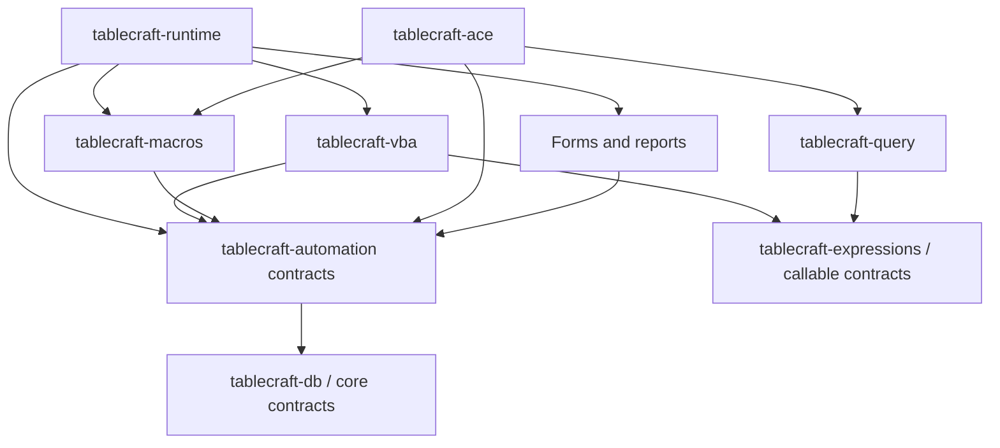

# VBA, macros and automation compatibility

TableCraft adopts native VBA preservation, documented execution and native
authoring as core interoperability requirements. The goal is to preserve existing
Access projects losslessly, execute a progressively qualified subset of VBA and
the Access object model, and create or modify supported native modules that
remain editable and executable in Access. Each part requires separate evidence.

This is an architectural decision, not implemented language support. There is no
VBA parser/interpreter, macro engine, project extractor/writer, DAO/ADO object
model, automation host, debugger or corresponding CLI command today. SQL syntax
can represent calls, but the current evaluator rejects them. The supplied ACCDB
has not been inspected for modules or executed. See [IMPLEMENTATION.md](IMPLEMENTATION.md).

## Owners and dependency boundaries

The planned packages below are introduced only with working functionality. The
`application/` directory groups domains; reusable contracts and headless execution
inside it must not import the graphical application or session runtime.

| Owner | Responsibility |
| --- | --- |
| `tablecraft-vba` | VBA source parsing, diagnostics, semantic analysis, module/procedure/class model, language execution, errors and debugger primitives |
| `tablecraft-macros` | Access visual/embedded macros and table data macros, with distinct syntax and execution rules from VBA |
| `tablecraft-automation` | Small reusable host contracts for commands, authorized object dispatch, database/recordset access, transactions and events; no concrete runtime or engine construction |
| `tablecraft-runtime` | Application/session host implementations, form/report instances, event coordination, navigation and composition of language engines |
| `tablecraft-ace` | Native storage/project codecs, opaque preservation and required database write semantics; no form/report rendering or application-runtime dependency |
| `tablecraft-expressions` / `tablecraft-query` | Reusable scalar evaluation and query execution; future narrow callable interface, independent of concrete VBA/runtime implementations |

The intended dependency arrows below point from consumer to dependency; they are
not the current Cargo graph. Calls back into a host use interfaces, not reverse
package imports:

The automation contract package must not depend on VBA, macros, query execution,
the native engine, concrete adapters or the application runtime. The runtime and
native engine can provide different host implementations. A standalone native
engine must run supported transaction-scoped data macros headlessly, or reject
writes requiring unavailable/unauthorized semantics. It must not require UI
initialization or silently bypass required validation.

## Preservation and native authoring

Discover and retain standard modules, form/report class modules, user classes,
project references and native metadata. Preserve names, source bytes and encoding,
module kind/scope, form/control/report event bindings, conditional compilation
metadata, reference identity/version and unknown structures. Keep original bytes
separate from parsed or normalized source. A form/report with no class module
must remain distinct from one with an empty module; inspection must not create it.

Lossless preservation means retaining unmodified project/object streams and
unknown metadata through unrelated supported database changes, with byte-level
and native reopening checks. It does not mean that an entire legitimately edited
database file remains byte-identical. If safe preservation cannot be established,
reject the modifying operation rather than dropping or reconstructing unknown data.

MS-OVBA informs project/module storage research, but does not by itself establish
Access-specific MDB/ACCDB object storage or valid writer behavior. Authoring needs
explicit source/compiled-state/cache handling and native verification, not merely
inserting text into a stream. Preserve unsupported references without pretending
they resolve. ACCDE/compiled application behavior is a separate profile; absent
source must not be fabricated or described as editable source compatibility.

## Language and host behavior

Start with an interpreter of the supported VBA language, retaining source
locations and inspectable execution state. A bytecode VM can follow measured
needs. Rust/JavaScript/Rhai translation is not selected as a substitute for VBA
semantics; no interpreter dependency has been adopted by this decision.

Initial language work covers procedures/functions, declarations, variables,
expressions, control flow, calls and basic errors. Explicit later profiles cover
ByRef aliasing and write-back, Variant subtypes, Empty/Null/Missing, objects and
Nothing, Set, optional/named arguments, default properties, classes, late binding,
On Error/Resume and reference resolution. Core stored `Value` and the current
checked Int64/Double expression profile are not a complete Variant runtime or a
promise of native promotion, Decimal range or error behavior.

DAO compatibility needs observable database, workspace, table/query definitions,
field/index/recordset behavior, cursor/edit state, transaction ownership and
errors, rather than just accepting DAO names. ADO support is independently scoped.
CurrentDb, Me, forms/controls, reports and DoCmd resolve through host contracts and
the actual application session. Dialogs, navigation, exports and printing belong
to host implementations; they are unavailable in a headless host unless supplied.

Cancellation-capable form validation must run before accepting the affected
record update. Record/control state, event order, reentrancy, nested DAO calls and
transaction lifetime require explicit profiles and differential tests. A form
BeforeUpdate handler does not imply that every DAO operation or external side
effect inside it participates in one rollback-able database transaction. Do not
commit the affected update first and invoke its cancelable validation afterward.
Reports similarly need qualified section, formatting, pagination and event behavior.

## SQL calls and debugging

Introduce a narrow callable/function contract with the first working UDF
consumer. Query/expression code calls a supplied implementation; it must not
import the VBA interpreter or whole application runtime. VBA may implement that
contract, and a standalone host may register the supported functions.

The contract must describe argument modes/omission, result and error propagation,
authorization, cancellation and shared budgets, transaction/session context,
reentrancy, determinism/volatility and external side effects. A user function is
not assumed pure or safe to duplicate, cache, reorder or replay. Unsupported or
disabled code fails explicitly; SQL function syntax alone does not authorize it.
No such registry or UDF invocation exists in the current scalar evaluator.

Keep breakpoint locations, frames, stepping, locals and error state in the
language engine; editor, completion, watches and Immediate Window UI belong to
developer tooling. Inspection must not silently invoke getters/functions with
external side effects. State lifetimes and debugger mutation policy require their
own tests, rather than being inferred from syntax highlighting.

## Execution policy

Open untrusted content with executable code disabled by default. Inspecting
tables, references or source, editing source, and executing it are separate
operations. Startup code, event handlers, macros, SQL UDFs and object activation
all pass through trust/capability policy. Missing/blocked dependencies produce
specific compatibility failures rather than successful-looking defaults.

Capability restrictions inside an ordinary process are not a security sandbox.
Stronger isolation needs explicit process/OS boundaries and tested protocols.
File, process, network and external application access remain authorized host
operations. No provider or platform bridge should be selected to evade a denial.

## Capability tracks and acceptance

These tracks can progress in parallel with storage/query work; they do not mean
VBA research waits until the database engine or desktop UI is complete.

| Track | Acceptance required before claiming the capability |
| --- | --- |
| VBA-0 preservation | Discover projects/references, preserve original streams through supported unrelated edits, compare bytes and reopen in actual Access |
| VBA-1 source language | Parser/model, source diagnostics and a bounded evaluator for documented procedure/value/control-flow/error subsets |
| VBA-2 Access/DAO | Supported CurrentDb/recordsets, object references, Me/controls and DoCmd behavior through working hosts, including headless rejection of unavailable services |
| VBA-3 events/UDFs | Qualified event order/cancellation, transaction/error interaction, supplied SQL callable integration and macro interaction |
| VBA-4 native authoring | Save supported new/edited projects; verify Access can discover, edit and execute those procedures on test copies |
| VBA-5 tooling/advanced | Debugger/editor consumers, classes, late binding, qualified references and scoped external automation |

Record exact Access/DAO/VBA builds, file formats, architecture, locale and profile.
Compare authored procedures' values, errors, record/object changes, event traces,
transaction outcomes, ByRef effects, module metadata and disabled-code behavior.
Source round trips, native authoring and execution are separate evidence; a
source parser passing does not establish any of them. Native fixtures need the
provenance/license review in [FIXTURES.md](FIXTURES.md), and experiments use copies.

## Primary references

These references were reviewed on 18 October 2026 as inputs for future work, not
as proof of implemented compatibility:

- [MS-OVBA introduction](https://learn.microsoft.com/en-us/openspecs/office_file_formats/ms-ovba/b39ac32f-0ce1-4533-9297-2ff3ff62c9ec) and [VBA storage](https://learn.microsoft.com/en-us/openspecs/office_file_formats/ms-ovba/b693e0ba-489f-4ac8-ac9d-6387fb5779bb): project/module storage research; Access container behavior requires separate investigation.
- [MS-OVBA versioning](https://learn.microsoft.com/en-us/openspecs/office_file_formats/ms-ovba/4d20e95c-0c17-47d6-84b9-8da95d8ea129): interoperable project representations and version-dependent caches must be distinguished in writer research.
- [HasModule](https://learn.microsoft.com/en-us/office/vba/api/access.form.hasmodule): presence/absence of a form or report class module is meaningful, including effects of accessing module properties.
- [Form.BeforeUpdate](https://learn.microsoft.com/en-us/office/vba/api/access.form.beforeupdate-event) and [its binding property](https://learn.microsoft.com/en-us/office/vba/api/access.form.beforeupdate-property): cancellation and event binding are observable behavior.
- [DAO Workspace.BeginTrans](https://learn.microsoft.com/en-us/office/client-developer/access/desktop-database-reference/workspace-begintrans-method-dao): transaction scope must be modeled explicitly rather than inferred from UI events.

Windows/API-dependent execution follows [WINDOWS_COMPATIBILITY.md](WINDOWS_COMPATIBILITY.md),
the separate planned provider workstream. The language engine calls shared host
contracts instead of importing wincompat/native providers. Preserving code is
independent of being able or authorized to execute every referenced component.
