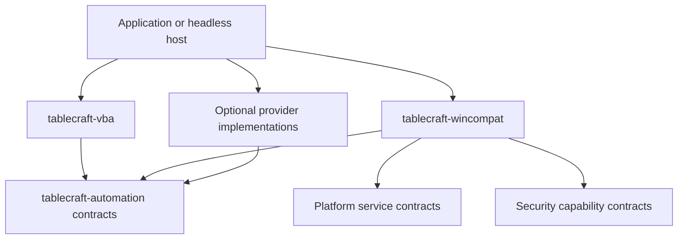

# Windows API compatibility providers

TableCraft adopts API-level compatibility as a first-class part of running
supported Access applications on Windows, macOS and Linux. The goal is unchanged
VBA source where a qualified implementation of its dependencies is available,
with explicit reporting of unsupported or unauthorized behavior. This is not a
commitment to emulate Windows as a whole or run arbitrary Windows binaries.

The planned product package is `compatibility/tablecraft-wincompat`, distinct
from engineering-only `tablecraft-compat`, which owns native comparison tooling.
Neither exists today. There is no object/provider registry, COM bridge, Win32
shim, virtual filesystem/registry, Windows binary loader or provider plugin
implementation. The current CLI does not execute VBA, instantiate objects or
invoke external APIs. The six working Cargo packages contain no Windows compatibility providers.

## Ownership and provider selection

VBA owns language semantics; `tablecraft-automation` owns reusable host/object
contracts; `tablecraft-wincompat` supplies compatibility dispatch and provider
integration. Application or headless hosts compose registered implementations.
The interpreter need not know whether a call is Rust-backed, emulated, bridged
or serviced externally. Query code must not import the compatibility dispatcher.

These are intended consumer-to-dependency arrows, not current Cargo dependencies.
Contracts must not import concrete providers or the application runtime. Dialog
providers call supplied UI services; a headless provider reports unavailability
instead of pulling a graphical dependency into the language or native engine.
Windows bridges/native helpers must remain optional and target-appropriate.

| Mechanism | Intended use |
| --- | --- |
| Direct Rust implementation | Supported language built-ins, Access/DAO objects and collections, with their owning semantic package |
| Cross-platform API emulation | Qualified Windows-facing scripting/path/environment behavior over authorized host services |
| Native bridge | Authorized real COM/Win32 or installed-application behavior on a supported Windows host |
| External service/provider | A separately configured integration, including a possible remote or isolated helper; never automatic fallback |

Resolve each call against registered API identity/version, signature, provider
availability, coverage profile and authorization before activation or side
effects. Preserve CreateObject/GetObject distinctions, including optional server,
pathname, active-instance and omitted-argument behavior where supported. Do not
turn object lookup or dependency discovery into an implicit launch of Office,
a DLL, a remote host or active file content.

## Dispatch contract and compatibility status

The shared object contract needs method calls, property get/put/reference
assignment, named/optional arguments and omission, ByRef/write-back, Variant
coercion, default members, object identity/lifetimes, reference/type-library
resolution, locale context and error propagation. A string-to-method-name map is
not sufficient. Native IDispatch marshalling belongs to the bridge; portable Rust
objects do not require a native COM ABI on every platform.

Reports may display the requested status vocabulary, but keep mechanism,
implemented coverage and authorization as separate underlying facts:

| Report status | Meaning |
| --- | --- |
| Native | Supported by a platform/native provider under its recorded coverage profile |
| Emulated | Supported by a compatibility implementation under its recorded profile |
| Partial | Only enumerated behavior/signatures are supported; operations outside that subset fail |
| Blocked | A potentially supported operation is denied by execution policy |
| Unsupported | No implementation of the required behavior is available |

Record API/type-library version, provider/version, signatures, architecture,
tested OS/locale, known limitations and evidence separately. A Native label is
not proof of complete compatibility; untested behavior stays unverified. Do not
retry a denied call through a different provider. Missing components, unsupported
members, provider failures and policy denial must remain distinguishable; they
must not become a plausible False, zero, empty string or success result.
VBA's explicit error-handling semantics may handle a reported error, but do not
grant a denied capability or authorize fallback through another provider.

Static discovery should report references, ProgIDs/CLSIDs, Declare signatures,
embedded controls, source locations, required capabilities and missing providers
without activating anything. Dynamic/computed object names, conditional branches
and compiled-only applications limit discovery: report uncertainty rather than
claiming that an absence of detected calls proves compatibility.

## Initial candidates and explicit boundaries

| Area | Planned implementation boundary |
| --- | --- |
| Access/DAO and supported ADO | Owned by the automation/database hosts described in VBA_COMPATIBILITY.md; not a Windows-only dependency |
| Scripting.Dictionary | Qualified collection behavior, including keys/comparison mode, default members and errors; not merely a HashMap with the same method names |
| Scripting.FileSystemObject | Qualified file/folder/text-stream methods through one authorized path/service layer |
| MsgBox/InputBox/dialogs | Supplied application services; explicit unsupported/cancelled behavior for hosts without them |
| Paths/environment | Explicit virtual drive, current-directory, environment and error semantics; no silent host-path guesses |
| Registry | Optional project-scoped virtual state or authorized Windows service; no fictional host registry on other platforms |
| WScript.Shell | A narrowly supported and authorized subset; no unrestricted process launcher by default |
| Selected Win32 declarations | Signature-checked allowlist with tested behavior, not arbitrary dynamic loading |
| Office/third-party objects | Separately qualified per-library or installed-application providers; document-library support does not imply full Office object-model compatibility |
| ActiveX, arbitrary DLLs/pointers | Preserve and report until a compatible implementation exists; no general cross-platform execution guarantee |

Internal feature modules can cover dispatch, scripting, filesystem, registry,
environment, shell, Win32, dialogs and providers when real code justifies them.
Do not scaffold empty modules or add Windows/runtime dependencies in advance.
Potential Wasm provider extensions use the planned capability-scoped plugin
boundary where suitable; native bridges may need a separately isolated helper.
Neither extension mechanism is implemented by this decision.

## Filesystem, environment and declared native calls

Project-configured virtual drives map to explicitly permitted roots. The VBA
filesystem object and application commands such as report export must use the
same resolver and authority context. Mapping a drive is not authorization to
access every host path. Validate the resolved operation, including traversal,
links and alias changes; a textual prefix replacement is not a containment check.

Compatibility profiles must define case handling/collisions, Unicode, separators,
UNC/drive-relative paths, current directories, encodings, metadata, file sharing,
locking and errors. A Windows drive-relative reference is not silently treated
as an absolute path. Unsupported path forms or ambiguous case collisions need
explicit failures. Virtual environment/registry data must not accidentally expose
host secrets or become a different way around file/process/network permissions.

For supported Declare calls, validate library/entry point, alias, calling
convention, argument modes, widths, structures, buffers, string encoding and
return/error behavior. PtrSafe alone does not establish correct pointer/handle
widths. Preserve legacy/conditional declarations and their target profile; do not
truncate pointers to make a declaration fit the host architecture.

Unknown declarations must not trigger arbitrary DLL loading. Raw pointers,
callbacks, window handles, shared memory and proprietary binary controls need
their own qualified mechanism. An emulated tick counter, delay, temporary path
or environment call must define its units, epoch/wrapping, scheduling, resource
and error semantics; returning a convenient approximate value is not sufficient.
No native bridge or unsafe-code policy exception has been introduced here.

## Execution and replication

Preservation, discovery, source editing and execution remain separate operations.
Untrusted executable content stays disabled by default, including object
activation, event handlers, macro calls and SQL UDFs. Capability restrictions and
faithful API emulation inside the application process are not a security sandbox.
Stronger isolation needs actual process/OS boundaries, resource limits and tested
protocols. Native/remote helpers require explicit configuration and authorization;
provider availability does not grant permission to use them.

Replicated data application must not redispatch ordinary user-triggered UI/VBA
events or repeat external effects such as sending mail on every peer/retry.
External effects need explicit execution ownership, stable operation identity,
retry/deduplication policy and a supported failure model; no exactly-once delivery
guarantee is implied. Database rollback does not automatically undo an external
operation. Store/dispatch separation or an outbox can be evaluated with a working
consumer rather than assumed to solve every provider's idempotency problem.

This rule does not permit replication to bypass required database constraints or
transaction-scoped data-macro semantics. Replication needs an explicit validated
apply profile and conflict/error behavior. Native Access shared-file mode remains
separate: participating applications own their events; native locking belongs to
`tablecraft-ace`, not this provider layer or the CRDT subsystem.

## Capability tracks and verification

| Track | Evidence required before claiming support |
| --- | --- |
| WIN-0 discovery | Inert reference/Declare/control inventory and compatibility report, including unresolved dynamic dependencies and disabled-code cases |
| WIN-1 dispatch | Working method/property/default-member/argument/ByRef/identity/error behavior against shared object contracts |
| WIN-2 common APIs | Qualified collections, filesystem, paths, environment and dialog hosts, with limits and denied-operation tests |
| WIN-3 Win32 shims | Enumerated signatures, 32/64-bit handling, buffer/error behavior and allowlist rejection |
| WIN-4 native bridge | Authorized installed Windows objects through an optional qualified helper, including unavailable component/process-failure behavior |
| WIN-5 extended providers | Explicit Office/vendor subsets, virtual/replacement controls and working extension providers with consumers |

Run authored supported cases against a provisioned Access/Windows oracle and the
TableCraft target platforms. Compare values, errors, object state, ByRef writes,
file/registry effects, denied operations, event order, resource limits, locale,
time and architecture boundaries. Preserve original fixture bytes and use copies.
Keep comparison tooling in engineering packages; unavailable targets are skips,
not passing coverage. These tracks run alongside VBA/native storage research;
no current tests establish any of these provider capabilities.

## Primary references

Reviewed on 18 October 2026 as specification inputs, not implementation evidence:

- [CreateObject](https://learn.microsoft.com/en-us/office/vba/language/reference/user-interface-help/createobject-function) and [GetObject](https://learn.microsoft.com/en-us/office/vba/language/reference/user-interface-help/getobject-function): activation/lookup inputs and distinct instance/file behavior.
- [IDispatch::Invoke](https://learn.microsoft.com/en-us/windows/win32/api/oaidl/nf-oaidl-idispatch-invoke): native Automation invocation context, arguments, member modes and errors.
- [FileSystemObject](https://learn.microsoft.com/en-us/office/vba/language/reference/user-interface-help/filesystemobject-object): file/folder/text-stream surface for subset qualification.
- [Declare](https://learn.microsoft.com/en-us/office/vba/language/reference/user-interface-help/declare-statement) and [64-bit VBA](https://learn.microsoft.com/en-us/office/vba/language/concepts/getting-started/64-bit-visual-basic-for-applications-overview): external signatures and pointer/handle architecture requirements.
- [Access database trust](https://support.microsoft.com/en-us/access/decide-whether-to-trust-a-database): background for distinguishing database access from enabled executable content.

See [VBA_COMPATIBILITY.md](VBA_COMPATIBILITY.md) for language/host boundaries and
[NATIVE_ENGINE.md](NATIVE_ENGINE.md) for standalone engine and native write rules.
